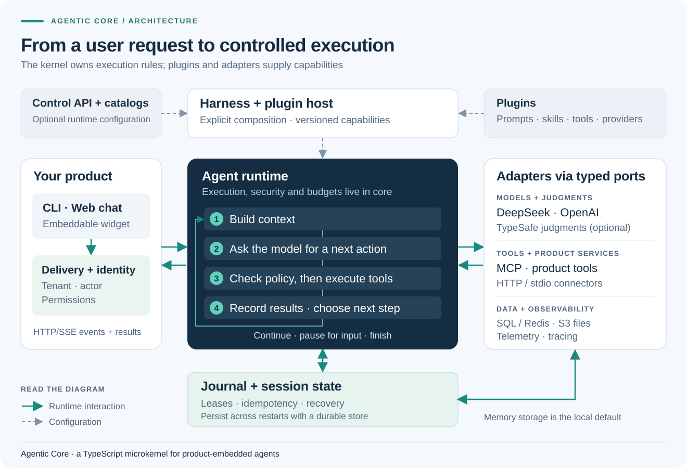

# Agentic Core

**A TypeScript runtime for agents embedded in products**

Agentic Core runs the loop between a user request, a model and the tools needed to do the work. It brings execution policy, context management and resumable state into one runtime, with a CLI, web chat and an embeddable widget

Your product supplies identity, business rules and integrations. The kernel owns the execution boundaries: permissions, budgets, approvals, state transitions and recovery

[Quick start](#quick-start) · [Architecture](#architecture) · [Web3 example](#a-read-only-web3-example) · [Documentation](docs/README.md)

## Architecture



[Open the diagram](docs/assets/architecture.svg) · [Download PNG](docs/assets/architecture.png)

The **harness** assembles the runtime. **Plugins** register capabilities with an explicit lifecycle. **Adapters** connect those capabilities to models, storage and external tools

Each request follows the same execution path:

1. **Establish authority** — resolve identity and permissions, admit the request and acquire a session lease
2. **Build context** — combine instructions, current work, relevant history and retained tool results within a budget
3. **Run controlled steps** — call the model, check tool policy and approvals, execute permitted work and record observations
4. **Finish or wait** — return an explicit outcome, or persist the interaction needed for an authorized continuation

Runtime snapshots stay immutable during a turn. Optional catalog routing lets new configurations be published while active work remains pinned to the runtime it acquired

### What the runtime handles

| Concern | Mechanism |
| --- | --- |
| Controlled execution | Tenant and actor context, tool permissions, approval gates, cancellation and execution budgets |
| Work that can resume | Ordered journals, idempotent requests, session leases and durable approval/interaction records |
| Long-running context | Budgeted prompts, compaction that preserves tool-call/result relationships, retained results and structured work state |
| Extensibility | Typed ports, owned plugin registrations, explicit activation and disposal |
| Evaluation during execution | Optional typed judgments for relevance and review; core seams can act or run in shadow |

Durability depends on the selected storage adapter. The default in-memory demo does not preserve sessions across process restarts

## Quick start

Requires **Node.js 22+** and npm

```sh
git clone https://github.com/0xsyncroot/agentic-core.git
cd agentic-core
npm ci
npm run build
npm run harness -- "Confirm that the runtime is working"
```

With no model credentials configured, the CLI uses the deterministic Echo adapter to verify the runtime wiring

### Run the chat with a real model

Copy `.env.example` to `.env`, then set:

```dotenv
AGENTIC_LLM_PROVIDER=deepseek
DEEPSEEK_API_KEY=your-key
```

```sh
npm run web
```

Open [the local chat](http://127.0.0.1:3400) or [the widget example](http://127.0.0.1:3400/widget-demo/)

The environment template enables a loopback development identity. Both the CLI and web app load `.env`; credentials stay on the server and the file is excluded from Git

### Optional typed judgments

Chat providers and judgment providers are configured independently. TypeSafe uses the pinned `jev-1.13.0` model for typed judgments

```dotenv
AGENTIC_JUDGMENT_PROVIDER=typesafe
TYPESAFE_API_KEY=your-key
AGENTIC_JUDGMENT_MODE=shadow
```

Shadow mode records core judgment-seam decisions for evaluation. Explicit judgment tools such as `rank_candidates` still return their normal results. Evaluate questions and thresholds against your product's own cases before enabling live core decisions

## A read-only Web3 example

The included example connects one chain-snapshot MCP tool to the full harness. It reads an EVM chain's ID and latest block, and can read a public address's native balance at that block hash

With a real model configured, add your RPC endpoint to `.env`:

```dotenv
WEB3_RPC_URL=https://your-evm-rpc-endpoint
```

```sh
npm run demo:web3
```

The example exercises tool discovery, permission checks, execution, retained results and model interpretation through the same runtime used by the chat. Its tool process receives only the RPC endpoint; model credentials remain in the harness

Only four read-only RPC methods are exposed. Signing and transaction submission are outside the example's capabilities. See the [example guide](examples/web3/README.md) for the RPC requirements and exact boundaries

## Included integrations

| Area | Implementations |
| --- | --- |
| Chat models | DeepSeek, OpenAI and a local Echo adapter |
| Typed judgments | TypeSafe |
| Tools and documents | MCP over HTTP/stdio, document readers and an optional document/file gateway |
| State and memory | In-memory, PostgreSQL, MySQL, SQL Server and Redis adapters |
| Object storage | S3-compatible storage through AWS SDK v3 |
| Observability | ELK telemetry and Langfuse tracing |

## Find your way around

| Path | Responsibility |
| --- | --- |
| `packages/core` | Turn execution and the security boundary |
| `packages/contracts`, `packages/plugin-sdk` | Shared ports, data and plugin lifecycle |
| `packages/plugins-base` | Replaceable tools, prompts and capabilities |
| `packages/adapter-*`, `packages/persistence-*` | Model, protocol, storage and observability implementations |
| `apps/harness` | Composition, catalog mounts and CLI |
| `packages/agent-api`, `apps/web`, `apps/widget` | HTTP/SSE delivery, local chat and embedding |
| `packages/control-api` | Separately authorized administration and catalog handlers |

Read the [architecture specification](specs/agentic-core-architecture.md) for invariants, the [code map](docs/architecture/code-organization.md) for ownership, or the [extension guide](docs/architecture/extension-guide.md) to add a capability

## Verification and deployment

```sh
npm run check
npm test
```

The full suite needs the Chromium and Python prerequisites listed in [verification](docs/verification.md). Database, S3 and execution-service tests have separate integration profiles with explicit external prerequisites

The repository provides reusable infrastructure and runnable development examples. Deploying it in a product requires that product's identity integration, authorization policy, durable storage, shared admission, secret management and service isolation. Tests establish specific runtime behavior; production capacity and model quality need validation in the target environment

For contribution conventions and review requirements, see [AGENTS.md](AGENTS.md)
