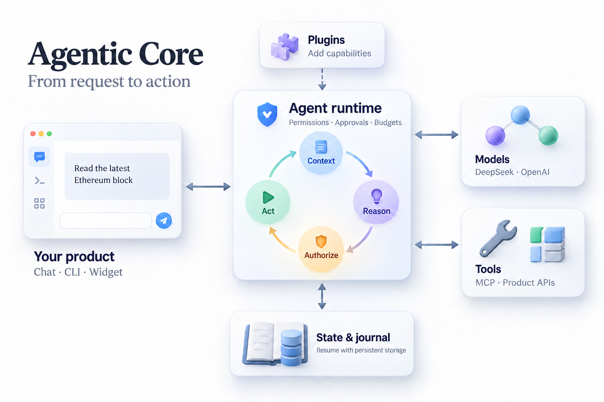

<h1 align="center">Agentic Core</h1>

<p align="center">
  <strong>A TypeScript runtime for building agents into your product</strong>
</p>

<p align="center">
  <a href="#quick-start">Quick start</a> ·
  <a href="#architecture">Architecture</a> ·
  <a href="#web3-example">Web3 example</a> ·
  <a href="docs/README.md">Documentation</a>
</p>

Give your agent tools, define what it can do and let work continue across approvals. Agentic Core provides the execution loop, context management and session state behind a CLI, web chat or embedded widget

- **Control tool execution** — apply permissions, approval gates and budgets before the agent acts
- **Resume work** — keep session history and pending interactions, with persistent storage for recovery across restarts
- **Extend the runtime** — connect models, tools and storage through typed adapters and explicitly registered plugins

## Architecture



Your product supplies identity and business rules. The **kernel** manages context, execution policy and state; **plugins and adapters** supply capabilities. The **harness** assembles them into a runnable application

[View full-size image](docs/assets/architecture.png) · [Explore the architecture →](specs/agentic-core-architecture.md)

## Quick start

Requires **Node.js 22+** and npm

```sh
git clone https://github.com/0xsyncroot/agentic-core.git
cd agentic-core
npm ci
npm run build
npm run harness -- "Confirm that the runtime is working"
```

With no model credentials configured, this runs the local **Echo** adapter. It returns a deterministic response so you can verify the runtime without an API key

### Start the chat

Copy [`.env.example`](.env.example) to `.env`, then run:

```sh
npm run web
```

Open the [chat](http://127.0.0.1:3400) or [widget demo](http://127.0.0.1:3400/widget-demo/). To use DeepSeek, set these values in `.env` and restart the app:

```dotenv
AGENTIC_LLM_PROVIDER=deepseek
DEEPSEEK_API_KEY=your-key
```

The local demo uses in-memory storage and a loopback development identity. Sessions reset when the process stops; provider keys stay in the backend

## Web3 example

Ask the agent to inspect an EVM chain's latest block or a public address's native balance. A single read-only MCP tool runs through the same harness as the chat

With DeepSeek configured, add `WEB3_RPC_URL` to `.env`, then run:

```sh
npm run demo:web3
```

The example exercises tool discovery, permission checks, execution and model interpretation. It supports chain reads only; no wallet keys, signing or transaction submission

[Run the example and check RPC requirements →](examples/web3/README.md)

## Go deeper

- [Architecture and invariants](specs/agentic-core-architecture.md) — execution, durable state and runtime snapshots
- [Build an extension](docs/architecture/extension-guide.md) — add tools, skills, model providers or storage
- [Configure the runtime](docs/architecture/environment-settings.md) — providers, TypeSafe judgments and deployment settings
- [Verify a change](docs/verification.md) — local checks, integration profiles and live-model evaluation

For a product deployment, connect your own identity and authorization policy, configure durable storage and validate the setup in your environment

## Development

```sh
npm run check
npm test
```

See [verification prerequisites](docs/verification.md) before running the full suite, and [contribution conventions](AGENTS.md) before making changes
