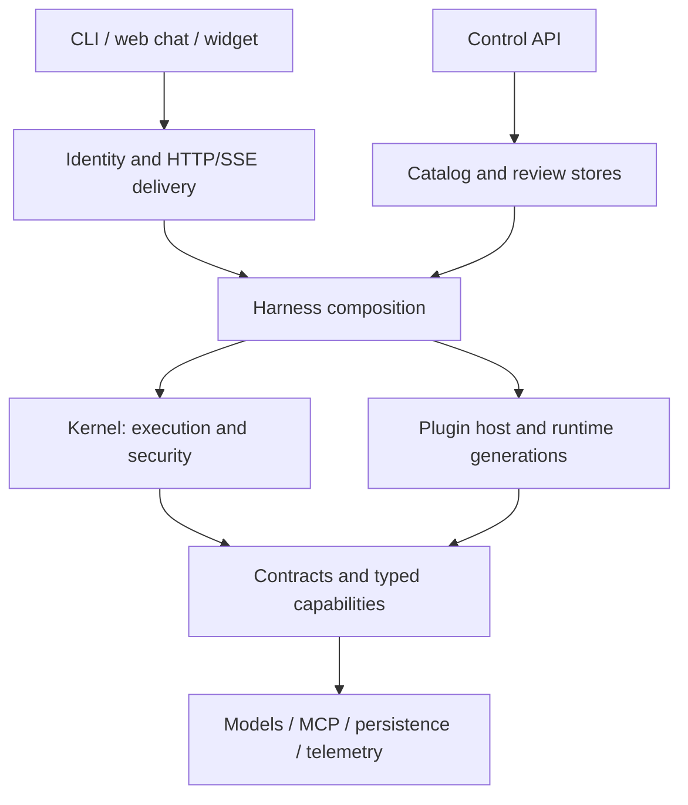

# Agentic Core architecture

## Scope and ownership

Agentic Core is a microkernel for product-embedded agents. Ports and adapters define the boundary to infrastructure. The kernel is deliberately authoritative over turn execution, tenant propagation, tool policy, approval, admission, budgets, leases and durable lifecycle

`contracts` defines data and ports; `plugin-sdk` defines manifests, capability tokens and lifecycle. `core` implements invariants. `plugins-base` contains removable capabilities. Adapters implement concrete providers and protocols. `apps/harness` assembles these layers. Delivery resolves identity before calling the runtime

The design takes inspiration from Cordis-style owned registration and scoped disposal. Execution and security are not replaceable plugins. Model output, tool output, retrieved documents and browser input never become authority merely by entering a prompt

## Plugin lifecycle and runtime generations

Manifests identify a plugin, version, publisher, artifact, required/provided capabilities and permissions. Activation is staged; registrations have owners and disposal follows reverse lifecycle order. Composition selects a trusted set of implementations explicitly; environment input cannot import arbitrary modules

A runtime snapshot identifies the assembled capability set and policy revisions. The harness can mount catalog generations through its runtime-provider seam. A turn acquires a runtime and pins the generation needed by durable continuation. Cached generations and their resources are released through lifecycle ownership, rather than being mutated beneath an executing turn

Catalog composition includes generation loading, capability assembly, model-route selection, shared infrastructure and cache management. It is an optional composition path, not a second implementation of the agent loop

## Turn, step and attempt

A turn is a user request in an authorized session. A step is one model decision and its associated tool work. Attempts record retries of work without conflating them with new user turns

The runtime validates security and admission, acquires session authority, records the request and builds context from durable state. It resolves the model route, allocates prompt/output budgets and executes bounded model steps. Tool calls pass policy and approval checks before dispatch. Observations, work state and delivery facts are journaled. Completion, partial completion, failure and waiting states are explicit outcomes

The kernel owns retry limits, cancellation, step/time/token budgets, progress accounting and termination. Decisions use structured facts and notices; a regex over the final answer is not proof of completed work. Delivery projections and private model reasoning are not authoritative execution state

## Durability and recovery

Session storage maintains ordered events, turn requests, leases and integrity information. Idempotency prevents a repeated request from becoming independent work. Recovery uses durable records and runtime pins. Presentation replay rebuilds what the UI should show; it does not blindly re-execute side effects

Tool intent and result remain paired. Compaction respects causal boundaries, unresolved work and human-interaction state. A paused invocation retains the information required for authorized continuation. Storage adapters must preserve the same lifecycle contract even when their transactional mechanisms differ

## Tools, approvals and human interaction

Tool discovery supplies provenance and schemas. Risk classification and required permissions belong to trusted configuration; a tool's description cannot grant itself authority. Tenant and actor context propagate through execution and connector credentials

Approval is a separate contract from general human interaction. Forms and external authorization steps use durable interaction records and resume through validated responses. The server bounds schemas, field counts, values and choices. Secret fields are external-only. A browser does not return provider credentials through a chat form

An external URL is presented for deliberate user action, not fetched automatically by the runtime. Connector authorization binds the user, server and allowed origin. The widget is a presentation client, never the authorization boundary

## Context and memory

The full event journal is the source of execution history. The model sees a budgeted projection: required instructions, current work, relevant history, retained tool-result references and optional knowledge/memory. Compaction reduces prompt size while preserving the data needed to resume work

Memory is tenant-scoped, permission-checked and database-first. Canonical records retain provenance and lifecycle metadata. Retrieval indexes are derived views, not a replacement for authoritative records. Long-term memory and conversational compaction are separate mechanisms

## Typed judgments

Judgment adapters return typed probability data through `JudgmentPort`. The runtime has explicit seams for relevance, observation review, work movement and related decisions. Each seam has a configured operating mode; shadow mode records the judgment without letting it change execution

The gateway adapter requires an explicit endpoint and model. System One likewise requires an explicit model and preserves its typed request/probability contract. These identifiers are deployment configuration, not bundled private model aliases. Changing judgment questions, thresholds or live modes requires labeled evaluation with difficult negative cases

## Delivery and administration

`agent-api` owns shared HTTP/SSE handlers, identity integration, resumable streams, history and interaction routes. `apps/web` supplies a loopback demonstration. `apps/widget` projects the protocol into an embeddable chat surface

`control-api` depends on contracts and remains outside the execution kernel. Review and catalog management need their own administrative identity and audit policy. An administrative read should be scoped and recorded; the control plane does not bypass turn authorization or write the journal as if it were the agent

## Deployment boundaries

Development may use Echo and memory storage. Production requires configured identity, durable storage, encryption, safe admission and an authorized runtime-provider composition. MCP deployments additionally need credential custody, egress policy and appropriate process isolation. The execution service is optional and must be deployed with its own containment controls

The included adapters and tests demonstrate implemented mechanisms. They do not establish capacity, availability, model accuracy or security of a particular deployment. See [verification](../docs/verification.md) for the distinction between offline, service integration and live-model evidence
